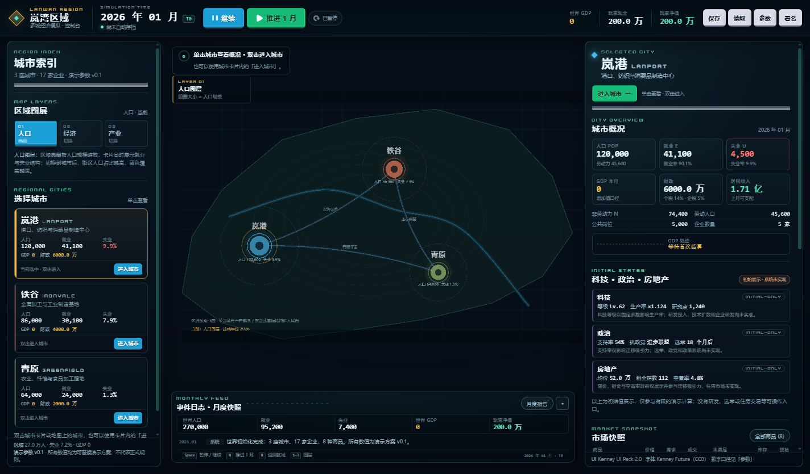
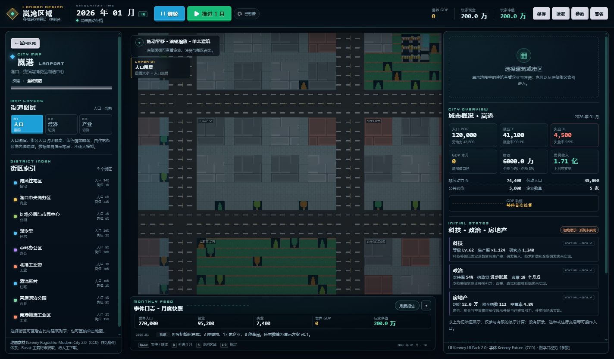
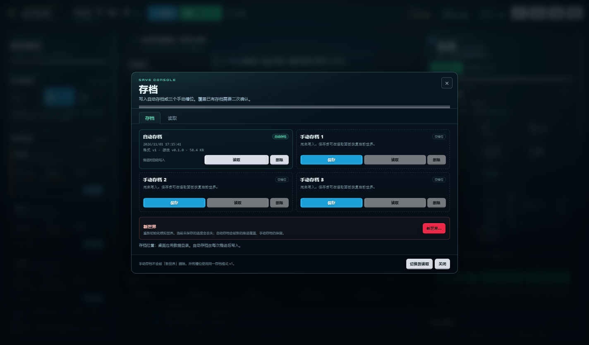
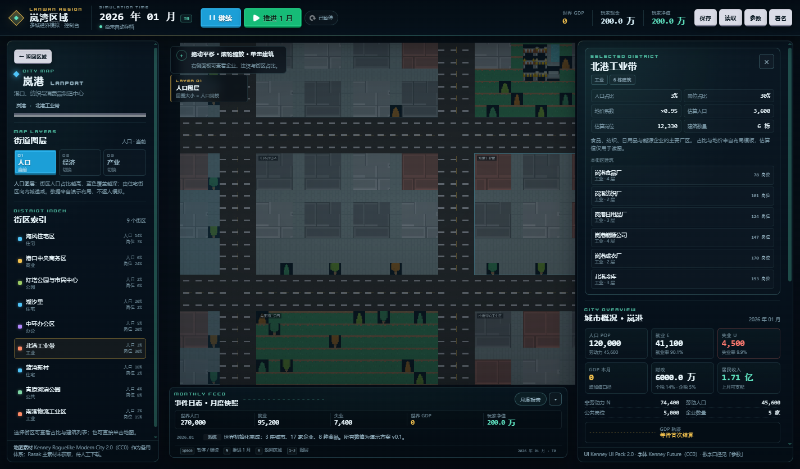

# 岚湾区域 · 多城市经济与政治模拟（可运行初版）

基于 **TypeScript + Phaser 3 + Electron** 的桌面经济模拟原型。首版交付一张三城市区域战略地图、一座可辨认的模块化城市街区、月度结算的最小经济闭环、玩家注资、确定性随机种子，以及带版本校验的存档/读档。

> 本版所有数值均为**可替换的演示参数**，不是最终策划规则。模拟中尚未完成的系统在界面和文档中明确标注为“初始展示/未实现”，没有用假按钮冒充完整功能。

## 快速开始（Windows）

环境：Node.js 20+（本机验证使用 Node v26.13.0 / npm 11.20.0）、Windows 10/11 x64。主要依赖：TypeScript 5.9.3、Phaser 3.90.0、Electron 38.8.6、Vite 7.3.7、Vitest 3.2.7、electron-builder 26.18.1。

```powershell
cd C:\CODING-worktrees\first-playable
npm install
npm run dev
```

`npm run dev` 会同时启动 Vite、Electron 主进程编译和桌面窗口。首次安装如果 Electron 二进制被 npm 的 install-scripts 策略拦截，可执行：

```powershell
node node_modules\electron\install.js
# 若仍缺少 dist\electron.exe，可手动解压缓存中的 electron-v38.8.6-win32-x64.zip 到 node_modules\electron\dist
```

### 构建、启动、打包

```powershell
npm run typecheck      # 渲染层 + Electron 主进程类型检查
npm test               # Vitest：守恒、确定性、存档、GDP 口径
npm run build          # 类型检查 + Vite 构建 + Electron 编译
npm start              # 启动已构建的桌面应用（electron .）
npm run package:dir    # 生成 release\win-unpacked（免安装目录）
npm run package        # 生成 Windows NSIS 安装包（需联网下载 NSIS/7zip）
npm run package:dir:cn # 同上（目录版），使用 npmmirror 镜像下载打包工具
npm run package:cn     # 同上（NSIS），使用 npmmirror 镜像下载打包工具
```

构建产物：`dist/renderer/`（Phaser/UI）、`dist/electron/`（主进程/preload）、`release/`（打包结果，已 gitignore）。

### 浏览器回退（仅开发/截图）

```powershell
npm run dev:web
```

浏览器模式没有 Electron IPC，存档回退到 localStorage；正式桌面存档请使用 Electron。

## 界面预览

| 区域战略地图 | 城市街区与街区面板 |
| --- | --- |
|  |  |

| 存档控制台 | 街区详情 |
| --- | --- |
|  |  |

截图来自实际 Electron 构建（`npm run smoke`），不是设计稿；界面在 1100×700 至 1440×900 均可操作。

## 操作

- **区域地图**：单击城市查看概况；双击城市节点或点击右侧“进入城市”进入城市地图。
- **城市地图**：滚轮缩放，拖拽平移；点击建筑/街区查看信息；顶部“返回区域”。
- **时间**：顶部“推进 1 月”/“暂停·继续”；快捷键 `N` 推进，`Space` 暂停/继续，`R` 返回区域，`1/2/3` 切换人口/经济/产业图层。
- **注资**：选中城市或企业后，在企业面板注资 5 万/10 万/25 万；玩家现金、企业现金、产能、股份会实际变化，并影响后续就业/生产。
- **存档**：顶部“保存/读取”；自动存档在每次成功推进后写入；重启应用会自动恢复自动存档。手动存档 3 槽；读取失败不会覆盖当前进度。
- **菜单**：Electron 菜单提供保存（Ctrl+S）、读取（Ctrl+O）、暂停、推进、资源署名、参数假设。

## 已实现

### 地图与界面

- 三座独立城市：岚港（港口/消费品）、铁谷（金属/工业）、青原（农业/纤维），有名称、位置、区域范围、人口与经济数据。
- 区域道路/贸易连接，贸易流按本回合实际成交显示；人口/经济/产业三种图层。
- 岚港城市地图：44×32 tile 模块化街区，3 像素/瓦片显示；道路、路口、人行道、住宅、商业、办公、工业、公共设施与公园；建筑可点击。
- 铁谷/青原复用模块化布局，使用不同城市名称、企业名称和经济数据。
- 界面：顶部 HUD（日期、暂停/推进、玩家现金/净值、存档）、城市列表、城市概况、市场表、企业列表/详情、贸易摘要、事件日志、科技/政治/房地产初始状态、参数与资源署名弹窗。

### 模拟

- 城市权威人口：`总人口 = 就业 + 失业 + 非劳动力`；就业分配到公共部门与具体企业；企业岗位分布合计 = 员工数。
- 企业岗位需求、员工、工资、现金、债务、产能、库存；劳动力匹配只能从本城失业人口招聘。
- 8 种商品（3 消费品 + 5 生产资料）与配方；企业按配方/库存/产能/资金采购并生产；居民消费受上一月可支配收入约束。
- 城市市场记录供应、需求（消费者/生产者分解）、成交、未满足需求、价格、进口/出口、期末库存；价格按供需与库存渐进调整。
- 企业间与跨城市贸易：8 条长期合同 + 区域市场补货；实际跨城市货物流动写入 `lastTick.tradeFlows`。
- 企业财务：销售、采购、工资、欠薪、利息、企业所得税、股息、产能调整；城市财政与居民收入。
- 游戏 GDP：按生产记录 `产出价值 − 中间投入价值` 汇总，明确不把营业额/工资/股票市值直接当 GDP。
- 确定性：mulberry32 种子状态随存档保存；相同初始状态 + 操作 → 相同结果（测试逐字节比较）。
- 月度结算失败时恢复到本期开始前快照，不留半期状态。

### 桌面与存档

- Electron `nodeIntegration: false`、`contextIsolation: true`、`sandbox: true`；preload 仅暴露存档/菜单/退出等最小接口。
- 存档含 `formatVersion`、`gameVersion`、`savedAt`、种子、RNG 状态、时间、世界状态；8MB 上限；临时文件 + rename 写入。
- 读取时校验 JSON、版本、世界结构和全部不变量；版本过新/损坏/不变量失败均明确报错，不覆盖当前进度。

## 测试与验证

```powershell
npm test
npm run typecheck
npm run build
npm run smoke        # 启动 Electron、截图区域/城市、推进、保存/读取并输出 JSON 结果
```

`npm run smoke` 需要已执行 `npm run build`。截图写入 `artifacts/`（gitignored）。

已验证（2026-11-01，本机）：

- `npm install` 成功（npm 11 对 Electron install-scripts 的拦截已手动处理）。
- `npm run typecheck` 通过。
- `npm test`：21 个测试全部通过（4 个测试文件）：24/36 期不变量、固定种子重现、跨城货流、注资、非法注资、存档往返/损坏/版本过新、GDP 口径；以及玩家分红拆分、损坏存档缺 `publicSector`/类型错误、自动存档保留、跨城交易失败回滚。
- `npm run build` 通过。
- `npm run smoke`：Electron 实际启动、区域/城市/建筑/存档截图、城市进入与返回、图层切换、推进 1 月、企业注资、手动保存→推进→读取、reload 后自动存档恢复、1100×700 无横向溢出；渲染层无 console error。
- `npx electron .` 实际启动并保持窗口。
- `npm run package:dir` 生成 `release\win-unpacked`（未签名、默认 Electron 图标）。

## 存档位置

Electron 使用 `app.getPath('userData')/saves/`，Windows 通常为：

```text
%APPDATA%\multi-city-sim\saves\
```

槽位：`autosave.json`、`manual-1.json`、`manual-2.json`、`manual-3.json`。

## 美术资源

- **城市地图**：Kenney Roguelike Modern City 2.0（CC0），`public/assets/city/kenney-modern-city-tilemap.png`，592×448，16×16，37×28=1036 tiles，spacing 0 / margin 0。
- **界面**：Kenney UI Pack 2.0（CC0），按钮/图标/分隔线/Kenney Future 字体，`public/assets/ui/`。
- **Rasak Modern Tilesets**：**未下载、未集成**。itch.io 的 Name Your Own Price 需人工完成购买/下载流程；本仓库没有 Rasak 文件，未绕过限制。人工步骤见 `docs/assets/ASSET_REPORT.md` 第 7 节。
- **Modern City Extension**：已下载核验（CC0，896×736），仅作备用参考，未复制进运行时、未混入主场景。
- 原始下载包在 gitignored 的 `assets/source-packs/`；运行时只分发已核验的 Kenney 子集。
- 完整来源/许可/哈希/预览：`assets/manifests/`、`docs/assets/ASSET_REPORT.md`、`assets/ATTRIBUTION.md`。

## 已知限制 / 未完成

- 科技、政治、房地产只有城市关联初始状态；研发、选举、政党、政策、住房/土地市场未实现，界面明确标注。
- 股票只有玩家注资/持股；无二级市场、控制权、董事会、并购、破产清算。
- 区域外净出口、营运资金信贷、债务重组是**演示稳定机制**，不是最终经济规则；需架构负责人决定是否保留。
- 运输成本/物流容量未模拟；区域补货只有价格楔子。
- 当前可能出现结构性失业/城市衰退（例如铁谷食品业收缩），没有再培训、产业政策、主动劳动力政策。
- 政府可赤字；福利按可用资金支付，公共工资仍按名义额支付。
- 城市地图为固定模块化布局；无土地购买、建造/升级、道路编辑。
- 无国家、军事、外交系统；无逐居民 AI/家庭模型。
- 打包使用默认 Electron 图标、未签名；正式发布需补图标和签名。

## 文档索引

- 项目总计划：`docs/PROJECT_PLAN_v0.2.md`
- 架构与数据边界：`docs/architecture/ARCHITECTURE.md`
- 初版实现记录（结算顺序/不变量/接口/演示规则）：`docs/architecture/IMPLEMENTATION_v0.1.md`
- 开发任务书：`docs/development/AGENT_TASK_V1.md`
- Git 协作：`docs/development/GIT_WORKFLOW.md`
- 素材核验报告：`docs/assets/ASSET_REPORT.md`
- 交付报告：`docs/development/DELIVERY_REPORT_v0.1.md`


