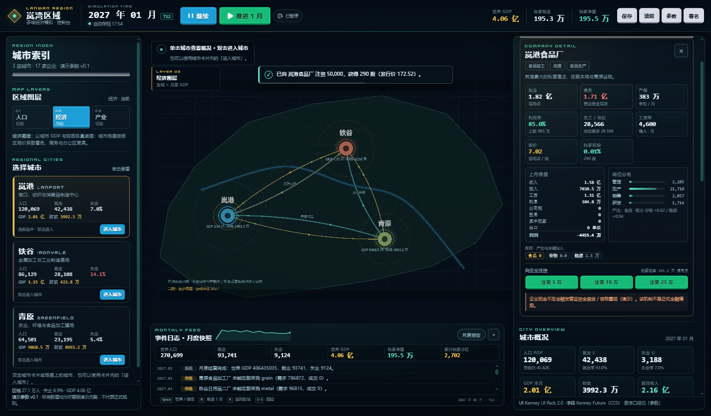
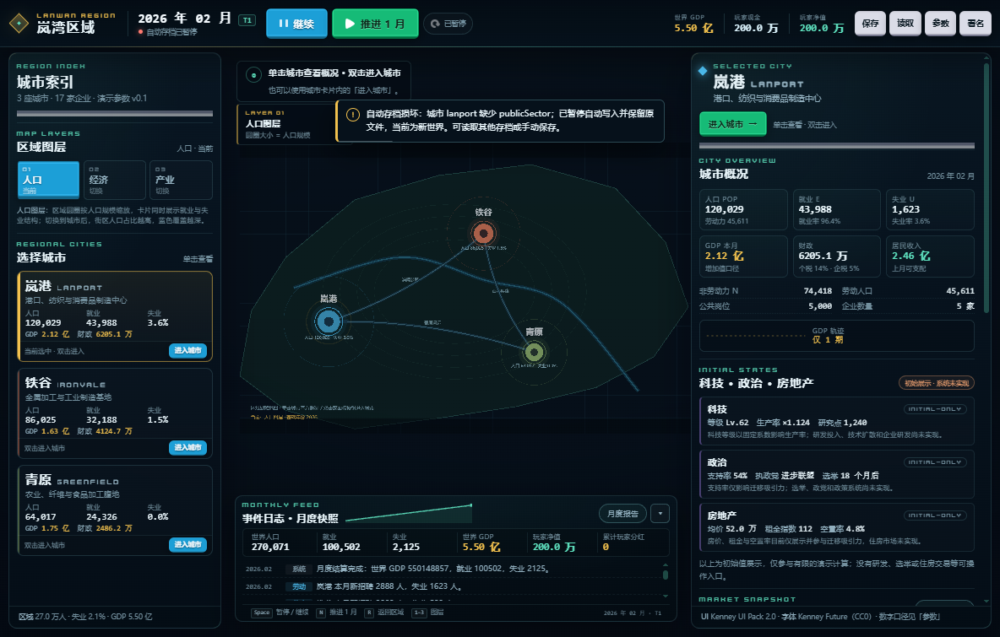

# 初版验收问题修复报告（v0.1.1）

- 基线交付：`306f16a`（`feature/first-playable`）
- 修复日期：2026-11-01
- 工作区：`C:\CODING-worktrees\first-playable`
- 分支：`feature/first-playable`
- 功能修复提交：`d3966e80d0096b89840bce6bb2ce60b911d9eaa7`（短号 `d3966e8`）
- 未推送远程；未合并 `main` / `develop`；未重做地图视角。

## 1. 玩家持股分红

### 根因

`settleCompanyFinance()` 把企业实际支付的 `dividendPaid` 全额写入 `dividendsByCity`，随后 `settleGovernment()` 把它全部计入城市居民收入；玩家持股只用于显示，未参与企业分红分配。

### 修复

- `src/simulation/finance/finance.ts`
  - 新增 `splitDividend(totalPaid, playerShares, totalShares)`：
    - `stake = clamp(shares / totalShares, 0, 1)`
    - `player = round2(totalPaid × stake)`
    - `other = round2(totalPaid − player)`
    - 因此 `player + other` 与 `totalPaid` 的差不超过 0.01（两位小数舍入）。
  - 企业实际支付股息后：
    - 玩家现金 `+= player`；
    - `player.dividendsReceived` 累计、`player.lastDividend` 本月值；
    - 仅 `other` 进入 `FinanceResult.dividendsByCity`；
    - 写入 `kind='player'` 事件：“\<企业\> 分红 X；玩家按 Y% 持股获得 Z 信用点。”
- `src/simulation/government/fiscal.ts`
  - 明确使用“非玩家股东股息” `residentDividends`，不再把玩家所得重复计入居民收入。
- `src/ui/panels.ts`
  - 企业详情增加“其中玩家”行（本月股息 × 当前持股，标注为估算，实际入账以事件日志为准）。
  - 月度快照增加“累计玩家分红”指标（`player.dividendsReceived`），即使旧日志被裁剪仍能看到累计实际所得。
- 旧存档兼容：`lastDividend` / `dividendsReceived` 为可选字段；旧存档缺失时 UI 回退 0，读取不报错。

### 测试

`tests/dividends.test.ts`（3 项）：

- 无持股：玩家所得 0，企业股息全部归居民股东。
- 50% 持股：玩家账户增加、居民股息减少、两者之和等于企业支付总额，且事件日志包含玩家分红。
- 1/3 不可整除持股：验证两位小数舍入后仍满足 `玩家 + 其他 = 支付总额`。

实际 Electron/模拟操作验证：注资 50,000 后推进 12 个月，首次实际分红 991.92，累计玩家分红 2,702.12；HUD 玩家现金同步增加，月度快照显示累计值。

## 2. 损坏存档与嵌套字段异常

### 根因

`validateWorldStructure()` 只检查 `city.population` / `city.market` 等顶层对象，未检查 `city.publicSector`；随后 `checkInvariants()` 直接访问 `city.publicSector.employees`，缺字段时抛 `TypeError`，绕过读取失败提示。

### 修复

- `src/simulation/core/save.ts`
  - 重写结构校验，覆盖城市、人口、公共部门、市场（8 种商品全部价格/供需/成交/库存字段）、财政、月度报告、科技/政治/房地产、企业/岗位/库存/上月财务、贸易路线、玩家持股、历史与日志、`lastTick` 数组及其条目。
  - 所有数值必须是有限数；字符串/对象/数组/布尔类型逐项检查。
  - 城市 ID、企业 ID 唯一；企业/路线/持股/玩家 homeCity 引用必须存在。
  - 缺 `publicSector` 返回 `城市 lanport 缺少 publicSector`。
  - `parseSave()` 包在 `try/catch` 中；校验器遗漏的嵌套字段也会转成“存档校验异常：...”而不是抛给 UI。
- `src/simulation/core/invariants.ts`
  - 在访问人口/公共部门/市场/企业 roles/inventory 前增加防御检查；缺字段时记录问题而不是抛 `TypeError`。
- `src/app/gameStore.ts`
  - `loadFromText`、`loadSlot`、`tryRestoreAutosave` 均捕获异常并提示。
  - 读取失败不替换 `this.simulation`，当前进度保持。
  - **自动存档损坏**：设置 `autosaveDisabled=true`，不删除/不重命名/不覆盖原文件；本会话后续 `autosave()` 直接跳过。UI 顶栏显示“自动存档已暂停”，toast 提示原文件保留，可用其他存档或手动保存。
  - 玩家显式读取有效手动存档或确认“新世界”后，才重新允许自动存档（这是明确的用户动作，不是启动时静默覆盖）。
- `src/ui/ui.ts`
  - `syncSaveNote()` 显示自动存档暂停原因，而不是误报“自动存档失败”。

### 测试

`tests/save-validation.test.ts`（5 项）：

- 缺少 `publicSector` → 明确错误，不抛异常。
- `population.total` 类型错误 → 明确错误。
- 损坏 JSON → 拒绝。
- `formatVersion=99` → 拒绝。
- 读取失败不改变 `GameStore` 当前状态。
- 启动时损坏自动存档 → `autosaveDisabled=true`，调用 `autosave()` 不写文件，当前世界仍可用。

实际 Electron 验证：把 `manual-1` 的 `cities[0].publicSector` 删除后写入 `autosave`，新窗口启动显示“自动存档损坏：城市 lanport 缺少 publicSector；已暂停自动写入并保留原文件”，`#hud-save-note` 显示“自动存档已暂停”；推进 1 月后文件字节完全不变。

## 3. 跨城交易失败的部分状态变化

### 根因

`executeTradeRoutes()` 在确认最终成交量/资金前调用了 `ensureLiquidity(importer, value)`。若只能借到部分资金，成交量随后被下调到不足最低 1 单位，函数 `continue`，但此前借款已经增加现金和债务。

### 修复

- `src/simulation/trade/trade.ts`
  - 先按 `现金 + creditAvailable()` 计算最大可负担数量，再与月目标、出口库存、进口需求取最小值。
  - 若数量 < 1（最低成交单位）或价值不足，直接跳过，**不融资**。
  - 只有所有条件（主体、城市、商品、配方、库存、需求、价格、资金/可用信贷）验证通过后，才在提交点同时执行：
    1. 需要时增加买方现金/债务（融资）；
    2. 转移货物；
    3. 转移资金；
    4. 更新收入/投入/出口统计；
    5. 写入贸易流与日志。
  - 提交前若最终资金校验失败，恢复融资前的现金/债务并跳过。
  - 无效主体/路线引用直接跳过，不产生任何状态变化。
- `src/simulation/production/production.ts`
  - 本地采购检查时，先确认确实存在投入缺口，再申请营运资金信贷；避免“无需采购却新增债务”。
  - 本地采购和区域补货仍是**按交易对手逐笔原子匹配**；单笔匹配要么成交要么不成交，允许跨多个卖家部分成交，未满足需求单独记录。这不是失败回滚，而是市场撮合的正常结果，已在文档注明。
- `src/simulation/labor/labor.ts`、`src/simulation/population/population.ts`
  - 复核：招聘/裁员先完成人数计算再统一同步；迁移先计算双方结果、验证后提交。未发现类似“失败后留下部分状态”的问题。

### 测试

`tests/trade-atomic.test.ts`（4 项）：

- **只能借到少量资金但不足以成交**（价格 50，信用额度仅 0.6）：无成交；买方现金/债务/库存/统计和卖方库存/统计完全不变（可捕获旧 bug 的 0.6 债务残留）。
- 成功交易（现金 500、成交 10 单位）：融资/货物/资金/统计/贸易流同时生效，买方现金 0、债务 0、库存 10，卖方库存 990、收入 500。
- 成功交易使用部分信贷（现金 100、额度 60、成交 3.2 单位）：买方新增债务 60、现金 0、库存 3.2；卖方收入 160，证明融资与成交一起提交。
- 无效交易主体：不抛异常、不改变任何主体。

实际状态对比通过测试断言（`toEqual` 快照）；桌面启动检查见第 4 节。

## 4. 实际验证

| 检查 | 命令/方式 | 结果 |
| --- | --- | --- |
| 类型检查 | `npm run typecheck` | 通过 |
| 全量测试 | `npm test` | **21/21 通过**（4 个测试文件） |
| 生产构建 | `npm run build` | 通过（仅 Phaser bundle 体积警告） |
| 桌面最小启动 | `npx electron scripts/smoke-main.cjs` | 通过；真实窗口、preload、存档 IPC |
| 分红实际操作 | 注资 50,000 → 推进 12 月 | 玩家现金增加；首月分红 991.92，累计 2,702.12；事件日志与月度快照可读 |
| 正常存读档 | 保存 2027-02 → 推进 2027-03 → 读取 | 回到 2027-02；reload 自动存档恢复 2027-02 |
| 损坏存档 | 缺少 `publicSector` 的 autosave | 显示明确错误；世界仍可用；推进后文件字节不变（未覆盖） |
| 交易失败回滚 | `tests/trade-atomic.test.ts` | 现金/债务/库存/统计前后完全一致 |
| 1100×700 | smoke 小窗口 | `scrollWidth = innerWidth`，无横向溢出 |
| 渲染 console error | smoke 采集 | 0 |

60 期手工回归（注资 50,000）：`checkInvariants=[]`，玩家累计分红 557,970.61，三城人口/就业/GDP/财政均为有限值；铁谷仍存在结构性失业，属于现有演示参数结果。

| 累计玩家分红（月度快照） | 损坏自动存档启动提示 |
| --- | --- |
|  |  |

## 5. 美术资源与视角状态

**Rasak：仍未取得，未集成，未核验包级许可。** 2026-11-01 复核官方页面：

- HTTP 200；Updated 2026-10-27；`Rasaks_Modern_Tileset.rar` 15 MB
- Name Your Own Price，`Download Now` 进入 `/purchase`，需要人工完成流程
- 页面标签 2D、**48×48**、RPG Maker MV/MZ、orthogonal；描述 40+ modern tilesets、允许商业/非商业与编辑但须署名 Rasak
- 页面文字不等于随包 LICENSE/README；包内许可、图集尺寸、间距、网格仍未核验
- 未绕过下载流程；未保留任何 Rasak 图片/截图/派生物；`assets/source-packs/` 仍无 Rasak 文件

**视角建议：**

- 官方截图显示正交方格、水平/垂直道路、俯视/3/4 建筑立面，**不是菱形等距**。
- 若采用斜俯视，**普通斜俯视（orthogonal 2.5D）比菱形等距更接近 Rasak 的素材形态**；菱形等距需要另一套真正的等距图块、坐标、碰撞和点击体系。
- Rasak 48×48 与当前 Kenney 16×16 顶视体系不兼容，必须整套替换并重排城市布局；不能混搭。本次没有修改地图视角或重做布局，等待架构负责人决定。
- 当前运行时继续使用已核验的 Kenney 备用体系；详见 `docs/assets/ASSET_REPORT.md` 第 12 节。

## 6. 仍未解决的问题

1. Rasak 仍未人工下载/核验；包级许可与 48×48 图块细节未知。
2. 视角选型（普通斜俯视/菱形等距）未决定；未重做地图。
3. 科技/政治/房地产仍为初始展示，未实现真实系统。
4. 股票仍只有玩家注资/持股，无二级市场、控制权、董事会、并购、破产清算。
5. 区域外净出口、营运资金信贷、债务重组仍是演示稳定机制，待架构负责人决定。
6. 运输成本/物流容量、再培训/产业政策、主动劳动力政策未实现。
7. 打包仍未签名、使用默认 Electron 图标；NSIS 打包需联网下载工具，CI 环境可能需镜像。
8. 本地采购/跨城补货的“跨多个卖家部分成交”是刻意行为；若未来要求整单全有或全无，需要新增订单簿/撮合事务层。

## 7. 文档同步

- `README.md`：测试数量、已知限制、修复说明入口。
- `docs/architecture/IMPLEMENTATION_v0.1.md`：分红拆分、存档校验、自动存档保留、交易提交点。
- `assets/manifests/sources.md`、`assets/manifests/asset-sources.json`、`docs/assets/ASSET_REPORT.md`：Rasak 复核日期、页面状态、48×48/正交说明与视角建议。
- 本文件：验收修复记录。

## 8. Git

- 基线：`306f16a`
- 本次功能修复提交：`d3966e80d0096b89840bce6bb2ce60b911d9eaa7`（短号 `d3966e8`）。本报告随后作为文档提交追加，最终 HEAD 以 `git log -1` 为准。
- 工作区：`C:\CODING-worktrees\first-playable`；分支：`feature/first-playable`。
- 未推送远程；未合并 `main` / `develop`；未重写历史。

