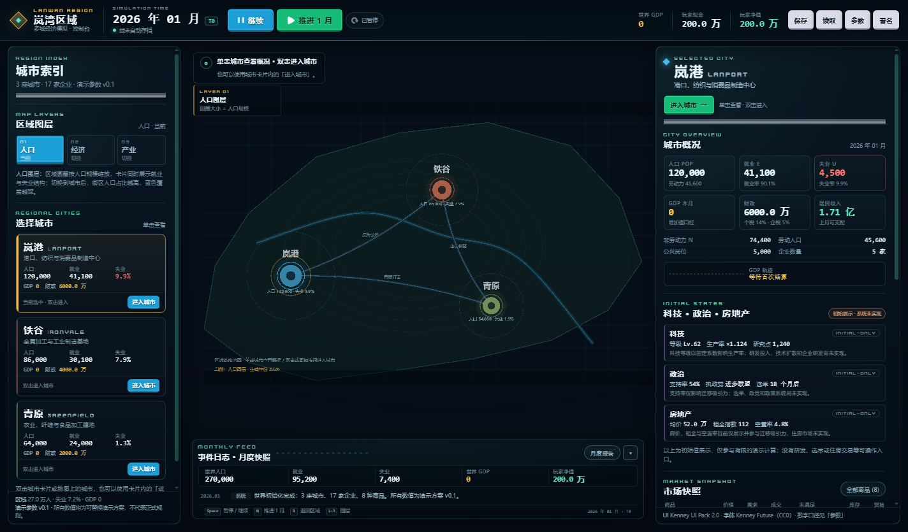
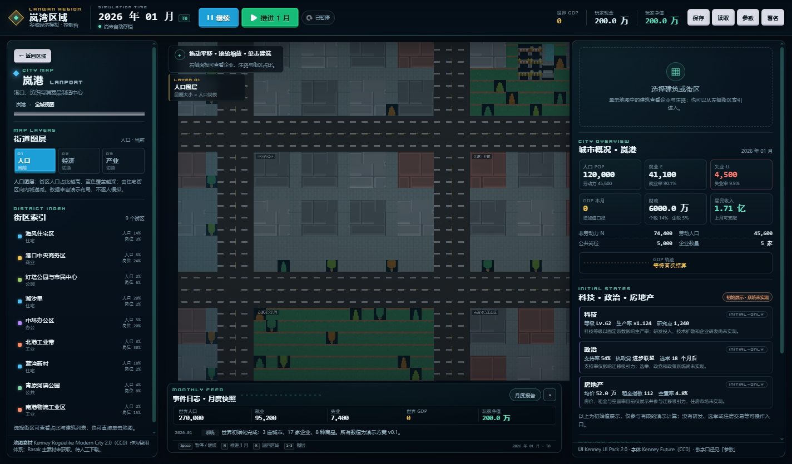
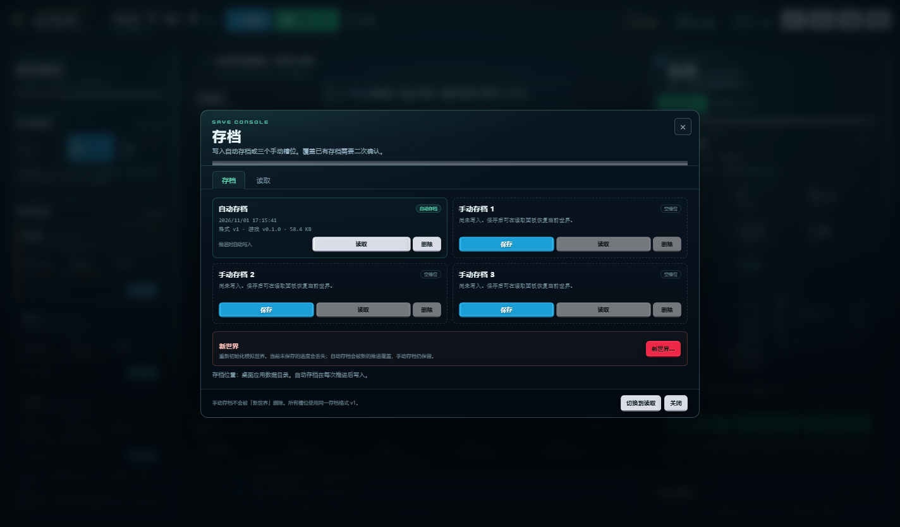
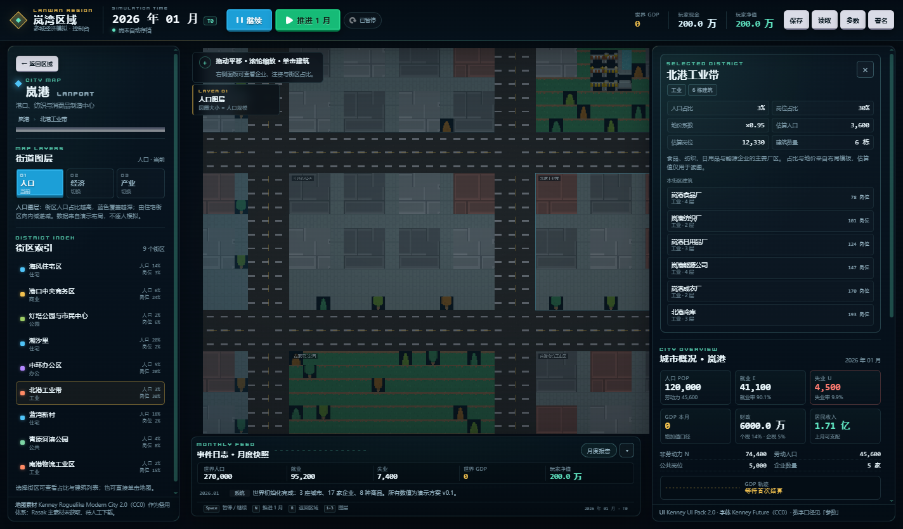

# 初版交付报告（v0.1）

日期：2026-11-01\
工作区：`C:\CODING-worktrees\first-playable`\
分支：`feature/first-playable`\
集成分支：`develop`（未合并）\
稳定分支：`main`（未修改）\
提交号：见文末“Git 提交记录”；本报告只记录实际执行的检查。

## 1. 交付内容

- Windows 桌面应用：TypeScript + Phaser 3.90 + Electron 38.8.6。
- 三城市区域战略地图（岚港/铁谷/青原），人口/经济/产业图层，跨城连接与实际贸易流。
- 岚港完整模块化城市地图（道路、路口、人行道、住宅、商业、办公、工业、公共设施、公园），铁谷/青原复用模块、不同名称与经济数据；建筑可点击。
- 月度结算最小经济闭环：人口、劳动力匹配、企业岗位/工资/现金/债务/产能、8 种商品、配方生产、居民消费、城市市场、跨城贸易、区域外净出口（演示）、财政、GDP。
- 玩家初始现金与注资操作（真实改变企业现金/产能/股份，影响后续模拟）。
- 科技/政治/房地产城市初始状态，明确标注 `initial-only`。
- 存档/读档/自动存档/重启恢复；格式版本、种子与 RNG 状态、世界状态、时间；读取失败不覆盖。
- 内建资源库：Kenney 城市图块 + Kenney UI Pack + 字体；Rasak 阻塞说明；Modern City Extension 仅备用参考。

## 2. 运行方式

```powershell
cd C:\CODING-worktrees\first-playable
npm install
npm run dev          # 开发启动
# 或
npm run build
npm start            # 启动构建产物
```

打包：

```powershell
npm run package:dir  # release\win-unpacked
npm run package      # NSIS 安装包
```

存档：`%APPDATA%\multi-city-sim\saves\`（Electron `app.getPath('userData')/saves`）。

## 3. 实际验证结果

### 3.1 依赖与构建

| 检查 | 命令 | 结果 |
| --- | --- | --- |
| 依赖安装 | `npm install` | 成功（393 packages；npm 11 拦截 Electron install-scripts，已手动补齐 Electron 38.8.6 二进制） |
| 类型检查 | `npm run typecheck` | 通过 |
| 生产构建 | `npm run build` | 通过（Vite 7.3.7；Phaser bundle 约 1.30 MB，gzip 约 362 KB；仅 chunk size 警告） |
| 打包目录 | `npm run package:dir` | 首次因下载 Electron 包超时失败；设置 `ELECTRON_BUILDER_BINARIES_MIRROR=https://npmmirror.com/mirrors/electron-builder-binaries/` 后成功生成 `release\win-unpacked\多城经济模拟.exe`（未签名、默认 Electron 图标）。 |
| NSIS 安装包 | `npx electron-builder --win --x64` | 首次下载 `7zip-win-x64` 时 `connect ETIMEDOUT 20.205.243.166:443`；设置同一镜像后成功生成 `release\多城经济模拟 Setup 0.1.0.exe`。 |
| 自动化测试 | `npm test` | 9/9 通过 |

### 3.2 Electron 启动与交互

使用 `scripts/smoke-main.cjs`（真实 Electron 窗口、真实 preload、真实存档 IPC）执行：

- 应用实际启动，`window.__lanwan` 就绪，3 城/17 企业加载；UI 的 `data-testid` 元素就绪。
- 区域地图截图、进入岚港城市地图截图、推进 1 月后截图、存档模态截图、选中建筑截图、1100×700 小窗口截图均生成于 `artifacts/`。
- UI 交互：点击城市卡片 → 点击“进入城市” → 城市视图（41 个建筑、9 个街区）→ 点击画布建筑（`selectedBuildingId` 非空）→ 点击“返回区域”成功；图层切换到经济成功；自动运行开关点击后 `autoRunning` true → false。
- 推进 1 月：日期 2026-01 → 2026-02；世界 GDP 从 0 → 5.50 亿（首次结算后）；玩家现金显示 200.0 万。
- 企业注资：点击岚港食品厂快捷注资 5 万，玩家现金 2,000,000 → 1,950,000，持股条目 +1；后续推进正常。
- 存档模态：保存按钮打开模态，Escape 后 `#modal-host` 隐藏且内容清空（`hidden=true, innerHTML.length=0`）。
- 手动保存 `manual-1` → 推进 → 读取：日期回到保存时点，读取成功。
- `win.reload()` 模拟重启：自动存档恢复，日期与 reload 前一致，界面显示“已恢复上次自动存档”。
- 1100×700 窗口：`documentElement.scrollWidth = 1084 = innerWidth`，无横向溢出。
- 渲染层 console error：0。
- 另以 `npx electron .` 直接启动真实主进程，窗口保持运行，无崩溃；`release\win-unpacked\多城经济模拟.exe` 也能启动并保持运行。

界面证据（实际 Electron 截图，已纳入仓库）：

| 区域地图 | 城市地图 |
| --- | --- |
|  |  |

| 存档控制台 | 街区详情 |
| --- | --- |
|  |  |

### 3.3 多期模拟约束

- `npm test` 中“连续推进 24 个月”通过：每期 `TickResult.ok = true`，`invariants = []`；人口 P=E+U+N、就业分配、岗位合计、库存非负、成交 ≤ 需求/供应、市场期末库存 = 企业库存合计。
- 额外手工运行 60 期：`checkInvariants` 返回空数组；期间有 14 条贸易流、4 条区域外出口；三城人口/就业/财政/GDP 均为有限值。
- 库存守恒审计每期执行：期初 + 产出 − 中间投入 − 居民消费 − 区域外出口 + 跨城净转移 = 期末；失败会回滚整期。

当前 60 期快照（演示参数，不是平衡目标）：

| 城市 | 人口 | 就业 | 失业 | 劳动力 | GDP（本期） | 财政 |
| --- | ---: | ---: | ---: | ---: | ---: | ---: |
| 岚港 | 121,198 | 43,913 | 2,142 | 46,055 | 187.7M | 54.8M |
| 铁谷 | 86,952 | 26,863 | 6,179 | 33,042 | 166.5M | 0.0M |
| 青原 | 65,127 | 20,735 | 4,013 | 24,748 | 236.3M | 321.4M |

说明：铁谷出现结构性失业（食品业收缩），当前未实现再培训/产业政策；这是模拟结果，不是隐藏失败。

### 3.4 确定性与存档

- 两次从相同种子/初始状态出发，执行相同注资与 12 期推进，`JSON.stringify(state)` 完全一致。
- 存档往返：`serializeSave` → `parseSave` 后 `world` 深度相等。
- 拒绝：非 JSON、`formatVersion=99`（高于当前）、篡改人口导致不变量失败；均返回明确错误，不覆盖当前进度。
- Electron 主进程存档：槽位名正则、8MB 上限、JSON/结构校验、临时文件 + rename；读取不存在/损坏返回错误。
- 重启恢复：启动时读取 `autosave`，成功后提示“已恢复上次自动存档”；损坏时提示并开始新世界。

### 3.5 GDP 口径

- 每期 GDP = 该城所有生产记录 `outputValue − inputValue` 之和（负值被截为 0 仅用于展示汇总）。
- 测试“GDP 等于企业增加值合计”通过；未把营业额、工资或股票市值直接相加。
- 公共部门工资不计入 GDP；GDP 面板/文档明确标注“企业增加值口径，不含公共服务”。

## 4. 实际使用的素材

| 素材 | 来源 | 许可 | 使用范围 | 状态 |
| --- | --- | --- | --- | --- |
| Kenney Roguelike Modern City 2.0 | https://kenney.nl/assets/roguelike-modern-city | CC0 1.0（包内 License.txt） | `public/assets/city/kenney-modern-city-tilemap.png`，城市地图唯一图块体系 | 已下载、已核验、已集成 |
| Kenney UI Pack 2.0 | https://kenney.nl/assets/ui-pack | CC0 1.0（包内 License.txt） | `public/assets/ui/` 按钮/图标/分隔线/字体 | 已下载、已核验、已集成 |
| Modern City Extension | https://opengameart.org/content/modern-city-extension | CC0（页面声明） | 仅 `assets/source-packs/` 参考 | 已下载核验，未进入运行时、未混搭 |
| Rasak Modern Tilesets | https://rasak.itch.io/rasak-modern | 未核验 | 无 | **未下载/未集成**；itch.io Name Your Own Price 需人工流程，未绕过 |
| Pulse Everyday Streets | https://edfaygo.itch.io/pulse-everyday-streets-1616 | 未评估 | 无 | 未下载/未评估 |

- 原始 zip/PNG 在 gitignored `assets/source-packs/`，不提交 Git。
- 运行素材 SHA-256、尺寸、许可原文路径见 `assets/manifests/asset-catalog.json`、`licenses.json`、`docs/assets/ASSET_REPORT.md`。
- 图块实测：592×448，16×16，37×28=1036 tiles，spacing 0 / margin 0（`tilemap_packed.png`；`Tilesheet.txt` 的 1px 间距属于未分发的 `tilemap.png`）。
- 游戏内“资源署名”面板明确：Rasak 计划中但未下载/未集成；当前城市视觉为 Kenney 备用体系。

## 5. 已知问题 / 未完成

1. 科技、政治、房地产仅初始状态；研发、选举、政党、政策、住房/土地市场未实现，界面明确标注。
2. 股票仅玩家注资/持股；无二级市场、控制权、董事会、并购、破产清算。
3. 区域外净出口、营运资金信贷、债务重组是演示稳定机制，需要架构负责人确认是否保留。
4. 运输成本/物流容量未模拟；区域补货只有价格楔子。
5. 结构性失业可能出现（铁谷较明显）；没有再培训、产业政策、主动劳动力政策。
6. 政府可赤字；福利按可用资金支付，公共工资仍按名义额支付。
7. 城市地图为固定模块化布局；无土地购买、建造/升级、道路编辑。
8. 无国家、军事、外交；无逐居民 AI/家庭模型。
9. 打包默认 Electron 图标、未代码签名；正式发布需补图标/签名。
10. Electron 38.8.6 的 install-scripts 在本机被 npm 11 策略拦截，README 已给出手动修复步骤；普通环境通常可自动安装。
11. 生产构建有 Phaser bundle >500KB 警告，未做代码分割/懒加载。

## 6. 待架构负责人决定

- 是否接受“区域外净出口 + 信贷 + 债务重组”作为首版稳定机制，或改为封闭经济/银行系统。
- 区域贸易价格基准：当前按**买方城市价格**结算，是否改为到岸价/离岸价/关税。
- 公共部门规模、财政赤字与福利规则。
- 劳动力市场平滑（每月最多 8% 裁员）与服务业吸收结构失业。
- 科技/政治/房地产的下一步优先级和数据权威。

## 7. Git 提交记录

- **功能与实现提交：`502318a18172bad291b2b5d328c4fceaced66f6d`**（短号 `502318a`，`feat: first playable multi-city economic simulation`）。
- 本交付报告在此后作为文档提交追加；最终 HEAD 以 `git log -1 --format=%H` 为准。
- 未推送远程；未合并 `main`/`develop`；未重写历史；`main` 与 `develop` 均未修改。


